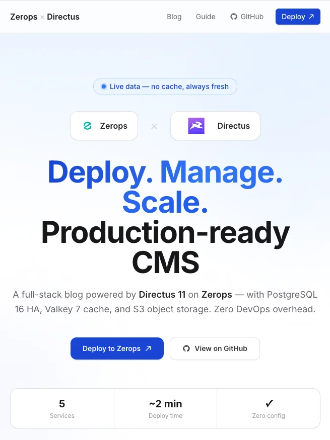

# Zerops × Directus Blog (Next.js frontend)

Next.js 16 blog that loads posts from a [Directus](https://directus.io) CMS on [Zerops](https://zerops.io). Application repo for the [directus-next](https://app.zerops.io/recipes/directus-next) recipe — deploy via that recipe (CMS + frontend + vault), not this repo alone.



---

## What you get

- **Homepage** — posts grid with cover images, categories, authors, excerpts
- **Post page** — markdown body, cover image, author bio, tags
- **Live CMS** — no database in this app; content from the Directus REST API
- **Zerops-ready** — `zerops.yaml` setups `nextjs` and `dev` (standalone Node.js 24)

---

## Tech stack

| Layer     | Technology                               |
| --------- | ---------------------------------------- |
| Framework | Next.js 16 (App Router, standalone)      |
| Styling   | Tailwind CSS 4 + `@tailwindcss/typography` |
| Markdown  | `react-markdown` + `remark-gfm`          |
| CMS       | Directus 12 (REST API)                   |
| Runtime   | Node.js 24                               |
| Platform  | Zerops                                   |

---

## Project structure

```
directus-next-frontend/
├── app/                    ← App Router pages (force-dynamic for runtime env)
├── components/
├── lib/directus.ts         ← typed Directus client
├── types/
├── .env.example
├── next.config.ts          ← standalone output, unoptimised images
├── zerops.yaml             ← nextjs + dev setups
└── README.md
```

Recipe `import.yaml` files live in [zeropsio/recipes/directus-next](https://github.com/zeropsio/recipes/tree/main/directus-next).

---

## Local development

### Prerequisites

- Node.js 24+
- A running Directus instance (deploy [directus](https://app.zerops.io/recipes/directus) or [directus-next](https://app.zerops.io/recipes/directus-next) on Zerops, or any Directus URL you control)

### Setup

```bash
npm install
cp .env.example .env.local
# Set DIRECTUS_URL and DIRECTUS_TOKEN in .env.local
npm run dev
```

Open [http://localhost:3000](http://localhost:3000).

| Variable         | Required | Description                                      |
| ---------------- | -------- | ------------------------------------------------ |
| `DIRECTUS_URL`   | Yes      | Directus base URL (no trailing slash)            |
| `DIRECTUS_TOKEN` | No       | Static token if collections are not public read  |

---

## Deploy on Zerops

1. Import the **[directus-next](https://app.zerops.io/recipes/directus-next)** recipe (choose an environment: stage, small production, etc.).
2. Zerops provisions PostgreSQL, Valkey, object storage, Directus (`zerops-recipe-apps/directus`), and this frontend.
3. Project vault supplies `API_URL`, `ADMIN_TOKEN`, and related URLs; `zerops.yaml` maps them to `DIRECTUS_URL` / `DIRECTUS_TOKEN`.

No manual env wiring is required when using the official recipe.

### zerops.yaml setups

| Setup    | Purpose                         | Runtime              |
| -------- | ------------------------------- | -------------------- |
| `nextjs` | Stage / production frontend     | `ubuntu/nodejs@24`   |
| `dev`    | Agent / local frontend service  | `ubuntu/nodejs@24`   |

---

## Directus API usage

```
GET /items/posts
GET /items/posts?filter[slug][_eq]=...
GET /assets/<uuid>?width=800
```

`DIRECTUS_TOKEN` is server-side only (React Server Components). Pages use `dynamic = 'force-dynamic'` so Zerops vault values are read at request time.

---

## Related

- CMS app: [zerops-recipe-apps/directus](https://github.com/zerops-recipe-apps/directus)
- Recipe docs: [zeropsio/recipes](https://github.com/zeropsio/recipes/tree/main/directus-next)

## Licence

MIT — Zerops recipe application.
